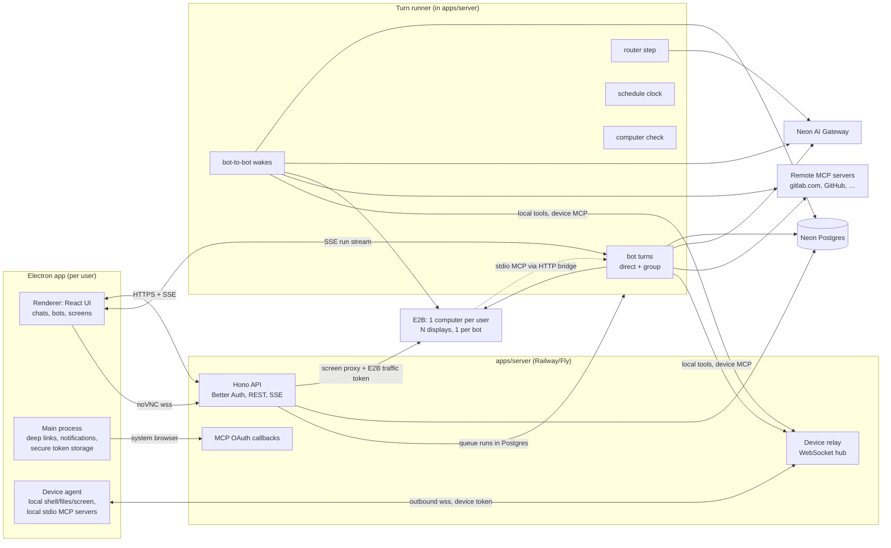

# PRD: AI Teammates Desktop App

> Working name: TBD (repo: `grok-bot-clone`)
> Status: Draft v1 · 2026-11-01
> Owner: you · Audience: you and your team

---

## 1. Summary

A **desktop app (Electron)** for a small private team where each person runs a crew of **AI teammates (bots)**. Every bot has a name, a job, its own instructions and its own memory. All of a person's bots share **one cloud computer** (an E2B sandbox, behind a pluggable provider layer) and each bot gets **its own screen** on it, so you can watch any bot work live. A bot can also run in **local mode**, using **your own Mac** (shell, files, screen) through a secure device bridge in the desktop app. Bots **message each other asynchronously**, coordinate in **group chats** with an automatic **router**, and use your apps through a **generic MCP connector layer**. It supports remote MCP servers (GitLab and GitHub first) and **local-command (stdio) MCP servers** on either the cloud computer or your Mac.

The product model follows xAI's **Grok Bot**. 
---

## 2. Goals and non-goals

### Goals
1. Bots that **do the work** on a real computer instead of describing it.
2. **Always on:** bots keep working, wake on messages and run schedules while your laptop is closed.
3. **Teamwork between bots:** async bot-to-bot messages, group chats with routing and clear ownership.
4. **Connect any app through MCP** with one generic layer and no per-app code.
5. **Safe by default:** approval before any write action, sign-in tokens never on the computer, a hard boundary between people.
6. **Your models:** every LLM call goes through **your Neon AI Gateway**.
7. **Local mode:** a bot can work on your own Mac (local repos, local apps, internal network) with per-command approval and a kill switch.
8. **Any MCP server:** remote (HTTP) servers and local-command (stdio) servers, on the cloud computer or on your Mac.

### Non-goals (v1)
- Billing, subscriptions, usage-based plans (private team app).
- Web or mobile clients (Electron only; a mobile app can come later on the same backend).
- Composio or any non-MCP connector framework.
- Public sign-up / multi-tenant SaaS.
- Local mode on Windows/Linux (macOS first; the bridge is cross-platform, screen control is per-OS).

---

## 3. Users and core scenarios

**Users:** you plus a small team. Each person has their own bots, their own computer and their own connected accounts.

| # | Scenario |
|---|---|
| S1 | "Create a bot named *Dev* whose job is triaging GitLab issues." Dev appears with an avatar, its own screen and memory. |
| S2 | Chat with Dev: "Reproduce issue #412 locally." Dev clones the repo on the shared computer, runs it, shows a screenshot, reports back. |
| S3 | Dev messages *Writer*: "Draft release notes from these merged MRs." Writer wakes, works, replies to Dev later. You see both threads in the sidebar. |
| S4 | Group chat "Release" with Dev, Writer, QA. You write "ship 2.3", the router picks Dev as owner, and Dev @mentions QA for a test pass. |
| S5 | Dev wants to merge an MR at 3am during a wake run. The run pauses, you get a notification, you approve from the desktop app, and the run continues. |
| S6 | A site needs a CAPTCHA or 2FA. The bot hands control to you in its live screen; you finish the step and click **Continue**. |
| S7 | You sign into Gmail once (in the browser on the shared computer) and all your bots can use that session. |
| S8 | "Every weekday at 9am, summarize new GitHub issues." A schedule wakes the bot daily. |
| S9 | You switch *Dev* to **local mode**. Dev runs `npm test` in `~/code/api` on your Mac (you approve the command once with "always allow `npm test`"), reads the failure and fixes the file. |
| S10 | Dev opens Xcode on your Mac and clicks through a UI flow. An overlay says "Dev is using your screen" and **⌘⇧Esc** stops it instantly. |
| S11 | You add a stdio MCP server (`npx @modelcontextprotocol/server-postgres <url>`) set to run **on this Mac**, so it can reach your local DB. Its secrets stay on your Mac. |
| S12 | You add a stdio MCP server set to run **on the cloud computer**, so all your bots can use it while your laptop is closed. |

---

## 4. Product decisions (locked)

| Area | Decision |
|---|---|
| Platform | **Electron** desktop app (macOS first, Windows/Linux later) |
| Audience | Private: you + team, no billing |
| Auth | **Better Auth** (on the backend, data in Neon) |
| LLM | **Neon AI Gateway** via `@neon/ai-sdk-provider` |
| Where agents run | **The backend** (`apps/server` runs every turn itself; Trigger.dev until 2026-11-07, see §14.2); the desktop app is a client |
| Computer | **One shared cloud computer per person**, one screen per bot |
| Computer provider | **E2B** (primary): memory-preserving pause/resume, custom templates, Firecracker microVMs. Behind a `ComputerProvider` interface so **Daytona** or a local **Docker** container can be swapped in (§8.1) |
| Local mode | A bot can run on **your Mac** instead; the agent stays in the cloud and calls tools on your Mac through the **device bridge** (outbound WebSocket from the desktop app) |
| Bot collaboration | **Async bot-to-bot messages** + **group chats with a router** |
| Connectors | **MCP only**, one generic layer; **remote (HTTP)** and **stdio** servers; stdio runs on the cloud computer or on your Mac; first remote: hosted **gitlab.com** and **github.com** |
| Codebase | Fresh build; port proven files from the references |

---

## 5. Feature requirements

Priority: **P0** = MVP, **P1** = v1, **P2** = later.

### 5.1 Auth and team
- **P0** Sign in with email/password or OAuth (GitHub/Google) via Better Auth. The Electron app uses the system browser for OAuth and returns through a deep link (`aiteam://auth/callback`).
- **P0** Allowlist sign-up (invite or domain allowlist) so only your team can join.
- **P1** Team roster; a teammate can share a bot with you (it runs on **their** computer and asks before using **your** accounts).

### 5.2 Bots
- **P0** Create, edit, delete a bot: name (≤50), job (≤100), instructions (≤4000), avatar (DiceBear seed).
- **P0** Creating a bot gives it a screen (display) on the owner's computer. Deleting it removes the screen, schedules, memories and threads.
- **P1** **Where it runs:** "Cloud computer" (default) or "This Mac" (local mode, §5.11). Switchable; memory and chats are kept.
- **P1** Per-bot model override (any model the gateway exposes).
- **P1** Per-bot connector allowlist.
- **P1** Pause or hide a bot, mute its notifications.

### 5.3 Chat (direct)
- **P0** One-to-one chat with a bot, streaming replies, Markdown/code rendering, image attachments.
- **P0** Readable activity stream: tool calls grouped as "Ran 3 commands", "Looked at the screen", "Opened MR !88", with a **Details** expander for raw inputs and outputs (openbots pattern).
- **P0** Stop button, and the turn keeps running if the app is closed or the network drops (durable).
- **P1** Search across chats, pin chats, reactions.

### 5.4 Shared computer and live screens
- **P0** One E2B sandbox per person, created on first use from our template, **paused** when idle (memory kept, so open browsers and screens come back as they were) and resumed on demand in about a second.
- **P0** Each bot has its own display; the chat shows that bot's **live screen** (noVNC) in a resizable side panel.
- **P0** Shared `/workspace` files and shared command-line credentials across all of the person's bots.
- **P1** Shared browser logins: sign in once and every bot can use the session (§8.4).
- **P1** **Takeover:** the bot pauses for CAPTCHA, 2FA, SSO or payment confirmation; you interact in its screen and click **Continue** / **Skip**.
- **P2** Computer settings: resolution, reset, recover, disk usage.

### 5.5 Memory
- **P0** Per-bot long-term memory in Postgres with `search_memory`, `save_memory`, `delete_memory` tools (openbots pattern).
- **P0** A few **shared user facts** visible to all bots (name, time zone, role), editable in settings.
- **P1** Memory sheet UI: browse, search, edit, delete a bot's memories.
- **P2** Semantic recall with pgvector on Neon.

### 5.6 Bot-to-bot messaging (async)
- **P1** `message_bot` tool: a bot sends a text message to another bot; the receiver **wakes**, handles it and may reply later.
- **P1** Bot-to-bot threads appear in the sidebar ("Dev ↔ Writer") and are read-only for you, with a "jump in" action.
- **P1** Loop guards: hop limit per chain, per-bot daily wake budget, "don't message other bots without asking me" rule (§10.3).
- **P1** One active task per bot at a time (queued otherwise).

### 5.7 Group chats and router
- **P1** Group chat with **2–6** bots, a name and a stated goal.
- **P1** Routing: an **@mention** or **Reply** goes straight to that bot; otherwise the **router** picks the responder (§10.4).
- **P1** Bots can post in the group and **@mention** each other to hand off work in the group.
- **P1** "Current owner" shown in the group header; one owner per stage.
- **P2** `@everyone` (rate-limited).

### 5.8 Connectors (MCP)
- **P1** Connections screen: catalog (GitLab, GitHub, Linear, Notion, Sentry, Slack, Atlassian, …) plus **"Add MCP server by URL."**
- **P1** One-click OAuth through the system browser; tokens stored encrypted on the backend.
- **P1** Type `@gitlab` in chat to attach a connector to a task.
- **P1** Approval cards for write actions; per-tool "always allow".
- **P1** Connections are per person and usable by all of that person's bots (optionally restricted per bot).
- **P1** **Add a stdio MCP server:** command, args, env vars, and where it runs: **cloud computer** (available 24/7 to all your bots) or **this Mac** (can reach local files, DBs, VPN; only while the app is open). See §9.8.
- **P1** Import stdio servers from an existing `mcp.json` / Claude Desktop config on your Mac.
- **P1** **Google (personal Gmail):** "Connect Google" gives bots Gmail (search, read, label, drafts, send with approval), Calendar (read, create events with approval) and Drive (search, read, create) through **our own first-party Google MCP server** (§9.10).
- **P1** **Email safety:** bots create drafts by default; every send needs your approval (can't be set to "always allow"); background runs can only create drafts.

### 5.9 Approvals and notifications
- **P1** Approval cards in chat (Approve / Deny / Always allow).
- **P1** Approvals during background runs pause the run and send a desktop notification; the run resumes when you answer.
- **P1** Native OS notifications for: bot replied while the app was in the background, approval needed, takeover needed, schedule finished.

### 5.10 Schedules
- **P2** "Remind me in 30 min", "every weekday 9am…": a `schedule_task` tool that creates Trigger.dev schedules; schedules UI to list, pause and delete them.
- **P2** Routines: save a demonstrated workflow as a reusable instruction set.

### 5.11 Local mode (bot uses your Mac)
- **P1** Enable "This Mac" in settings: the app registers the device and asks for macOS **Accessibility** and **Screen Recording** permissions (only needed for screen control).
- **P1** **Allowed folders:** pick folders the bot may read/write without asking (e.g. `~/code`). Anything outside asks first.
- **P1** **Shell on your Mac** with **per-command approval by default**; "always allow" by command pattern (e.g. `git status`, `npm test*`); a deny list (`sudo`, `rm -rf /`, credential stores) always asks.
- **P1** **Screen control** of your real screen (screenshot, mouse, keyboard) with:
  - an always-on-top overlay "Dev is using your screen",
  - a global **kill switch** (⌘⇧Esc) that stops the run immediately,
  - one bot controlling the mouse/keyboard at a time (device lock).
- **P1** **Device status** in the UI (online / offline / sleeping). If your Mac is offline, local tools return "This Mac is offline"; wakes for a local bot wait (up to 12h) and you're notified.
- **P1** Audit log of every local command and screen action, per run.
- **P2** Pause automatically when you touch the mouse/keyboard.
- **P2** Windows and Linux support.

---

## 6. Architecture

The flows in 6.4 to 6.8 are the original plan. Turns now run in `apps/server` instead of Trigger.dev; §14.2 records what changed.

### 6.1 System overview



**Principles**
- The **desktop app is a client.** It holds no secrets beyond the user's session token (stored with Electron `safeStorage`).
- **Agents run on the backend** so turns survive app close and long desktop tasks, and so bots can wake while you're away. A run is a Postgres row, claimed under a per-bot lock and kept alive by a heartbeat.
- **Neon Postgres is the source of truth** for bots, threads, messages, memory, connections and approvals.
- **Secrets never reach the computer** for remote connectors: MCP OAuth tokens and gateway keys live only on the backend. Exception, shown in the UI: env vars of a stdio server you choose to run **on the cloud computer** are injected into that process. Env vars of stdio servers on **your Mac** stay on your Mac (keychain).
- **One agent runtime.** Local mode does not run a second agent loop on the laptop. The cloud agent calls tools on the device through the relay, so durability, transcripts, memory and bot-to-bot all work the same.
- **The laptop never accepts inbound connections.** The device agent dials out to the relay; nothing listens on your Mac.

### 6.2 Tech stack

| Layer | Choice |
|---|---|
| Monorepo | pnpm workspaces + Turborepo, TypeScript |
| Desktop | Electron + `electron-vite`, React 19, Tailwind CSS 4, shadcn/ui, TanStack Router + Query, `@ai-sdk/react` (`useChat`), `@novnc/novnc`, `electron-builder` (+ auto-update later) |
| Device agent | Electron main process: `child_process` (shell), `desktopCapturer` (screenshots), a native input library for mouse/keyboard (e.g. nut.js; chosen in Phase 0), `@modelcontextprotocol/sdk` `StdioClientTransport` (local stdio servers), `ws` client, `globalShortcut` (kill switch) |
| Backend API | Hono on Node, Better Auth, Zod, typed client (`hono/client`) shared with the desktop app, WebSocket device relay |
| Agents | AI SDK v7, run by our own turn runner in `apps/server` (Postgres-backed queue, `croner` for schedules) |
| LLM | `@neon/ai-sdk-provider` → Neon AI Gateway |
| MCP | `@ai-sdk/mcp` (`createMCPClient`, HTTP transport, `authProvider`, `auth()`) |
| Computer | **E2B** SDK (`e2b` + `@e2b/desktop`: sandbox create/connect/pause, commands, files, `getHost(port)`, traffic access token) with a custom E2B template. Alternative provider: `@daytona/sdk` |
| DB | Neon Postgres, Drizzle ORM + drizzle-kit (pgvector later) |
| Observability | Sentry (desktop, server), the `runs` table |
| Hosting | Backend on Railway or Fly (one long-lived process); desktop builds via GitHub Releases |

### 6.3 Repository layout

```
grok-bot-clone/
  apps/
    desktop/            Electron app
      src/main/         window, deep links (aiteam://), notifications, safeStorage
      src/main/device/  device agent: relay client, local tools, screen control,
                        overlay + kill switch, local stdio MCP host, approvals cache
      src/preload/      typed IPC bridge
      src/renderer/     React UI (routes: chats, bots, groups, connections, devices, settings)
    server/             Hono API + Better Auth + MCP OAuth callbacks + SSE + device relay (ws)
  packages/
    db/                 Drizzle schema, client, migrations
    agent/              prompts, tool sets, model wrapper, router, turn runner, schedules
      src/model.ts        Neon gateway wrapper (from ai-teammates)
      src/prompts.ts      buildInstructions, group/memory/collab rules
      src/tools/computer.ts  shell/files/mouse/keyboard/screen; one interface,
                             two backends: CloudDisplayDriver | DeviceDriver
      src/tools/memory.ts
      src/tools/collab.ts    message_bot, handoff (@mention in group)
      src/tools/takeover.ts
      src/router.ts
    computer/           ComputerProvider interface + providers/e2b.ts (primary),
                        providers/daytona.ts (alternative); display manager,
                        browser sessions, screen proxy, stdio-MCP supervisor
      template/         E2B template: Dockerfile + build config (desktop, x11vnc,
                        websockify, xdotool, Chromium + Playwright, Node, uv,
                        supervisor, stdio→HTTP bridge)
    device-protocol/    zod schemas for relay messages (invoke, result, mcp frames,
                        heartbeat, kill), shared by server, tasks and desktop
    mcp/                generic MCP layer (catalog, authProvider, transports:
                        http | cloud-stdio | device-stdio, tool loader, approvals)
    api-client/         typed Hono client for the desktop app
    ui/                 shared React components
    config/             tsconfig, eslint/biome
```

### 6.4 Request flow: direct chat turn

1. The renderer calls `useChat` with **`useTriggerChatTransport`** (same pattern as ai-teammates). The transport asks the backend for:
   - `POST /chats/:id/session`: starts a Trigger `chat` session after checking chat ownership.
   - `POST /chats/:id/token`: mints a Trigger public token scoped to that session (read/write, 1h).
2. The **chat agent** (Trigger.dev) loads the chat, the bot and the user's computer, builds the system prompt, and resolves tools: computer tools (bound to the bot's display), memory tools, collaboration tools, and MCP tools for attached or allowed connectors.
3. `streamText` runs on the Neon gateway model with `stopWhen: [isStepCount(50)]`. Tokens stream to the renderer over Trigger realtime.
4. On turn completion, messages are **persisted to Neon** (`messages`), along with run and step telemetry. The thread's `lastMessageAt` and preview are updated.
5. If the app was closed mid-turn, the run finishes anyway; on reopen, the transcript loads from Neon.

### 6.5 Request flow: async bot wake

```
Dev (in any run) → message_bot({ to: Writer, text })
  1. insert message into thread kind=bot (Dev↔Writer), chainId, hop = parent.hop + 1
  2. reject if hop > MAX_HOPS, Writer's daily budget is spent, or Dev's owner set "ask first"
  3. tasks.trigger("bot-wake", { botId: Writer, threadId, messageId },
       { queue: "bot", concurrencyKey: Writer.id, idempotencyKey: messageId })
  4. return { sent: true } → Dev continues or ends its turn
bot-wake (Writer):
  5. load thread + memory + tools (bound to Writer's display) → generateText loop
  6. Writer may reply via message_bot(Dev), which wakes Dev with hop + 1
  7. persist messages, emit SSE "thread.updated", desktop notification
```

The concurrency key per bot gives **one active task per bot screen** (queued otherwise), matching Grok's model.

### 6.6 Request flow: group chat message

1. User posts in the group. Backend resolves responders:
   - @mention(s) or Reply → those bots.
   - Otherwise → **router** (§10.4).
2. For each responder, a turn runs on the chat agent with group instructions (members, goal, current owner).
3. If a bot's reply @mentions another bot, that bot is queued for the next turn (in-group handoff), subject to the hop limit and the `held` set (a request cannot bounce back to a bot that already held it in this chain).
4. Bot-to-bot `message_bot` calls made from a group land in the bots' own threads unless the bot is told to keep replies in the group (Grok behavior).

### 6.7 Request flow: local-mode tool call

```
Dev (local mode) calls bash({ command: "npm test", cwd: "~/code/api" })
  1. DeviceDriver (in the Trigger task) → POST /internal/devices/:deviceId/invoke
       { invocationId, runId, botId, tool, input }   (internal secret auth)
  2. Relay checks device belongs to the bot's owner and is online,
     forwards over the device's WebSocket, waits (per-tool timeout)
  3. Device agent policy check:
       allowed folder? command allowlisted? → run
       otherwise → native approval prompt in the app (and in the chat card)
  4. Executes, streams back { invocationId, ok, output | error }
  5. Relay returns it to the task → tool result to the model
Offline device → immediate error "This Mac is offline"; wake runs wait on a
Trigger wait token that the relay completes when the device reconnects (max 12h).
Kill switch (⌘⇧Esc) → device sends { kill, runId } → relay cancels the Trigger run.
```

v1 runs a **single relay instance** (device connections held in memory). Scaling to multiple instances later: route invokes through Postgres `LISTEN/NOTIFY` or Redis pub/sub to the instance holding the socket.

### 6.8 Request flow: stdio MCP tool call

- **On the cloud computer:** the stdio server runs inside the E2B sandbox, wrapped by a stdio→Streamable-HTTP bridge on a private port with a random bearer token. The MCP layer connects to it like any remote server at `https://{getHost(port)}` with the E2B traffic access token header plus the bearer header (§9.8.1).
- **On your Mac:** the device agent spawns the server with `StdioClientTransport`. The MCP layer uses a custom **`DeviceRelayTransport`** (implements the AI SDK `MCPTransport` interface) that tunnels JSON-RPC frames over the relay to the device, which pipes them to the process (§9.8.2).

---

## 7. Data model (Drizzle / Neon)

```
user, session, account, verification       Better Auth tables

computers
  id, userId (unique), provider (e2b|daytona), sandboxId, templateId,
  status (creating|running|paused|error), trafficToken (encrypted),
  resolution, lastActiveAt, lastResumedAt, createdAt

bots
  id, userId, name, avatar, job, instructions, model?,
  runsOn (cloud|device), deviceId?,
  displayNumber (unique per computer; kept even in local mode),
  status (active|paused|hidden), wakeBudgetDaily, createdAt

devices
  id, userId, name, platform (darwin|win32|linux), appVersion,
  tokenHash, status (online|offline), lastSeenAt,
  capabilities jsonb (shell, files, screen, input, stdioMcp),
  allowedPaths text[], createdAt

device_command_rules
  id, userId, deviceId, pattern, mode (always_allow|always_ask|deny), createdAt

device_actions                            audit log
  id, deviceId, runId, botId, tool, inputSummary, decision
  (auto|approved|denied), exitCode?, durationMs, createdAt

threads
  id, userId, kind (direct|group|bot), name?, goal?,
  currentOwnerBotId?, lastMessagePreview, lastMessageAt, createdAt

thread_members
  threadId, botId, joinedAt              (direct: 1 bot, group: 2–6, bot: 2)

messages
  id, threadId, authorType (user|bot|system), authorId,
  parts jsonb (AI SDK UIMessage parts), addressedToBotId?,
  chainId?, hop int default 0, runId?, createdAt
  index (threadId, createdAt)

runs
  id, userId, botId, threadId, trigger (chat|wake|schedule|group),
  status (queued|running|waiting|completed|failed|cancelled|skipped),
  payload jsonb, owner?, leaseUntil?, usage jsonb, error?, startedAt, completedAt, createdAt

run_steps
  id, runId, stepNumber, type (model|tool), toolName?, input jsonb,
  output jsonb (sanitized), status, createdAt

memories
  id, userId, botId (null = shared user fact), key, content,
  category, updatedAt, createdAt
  index (botId, key)

mcp_servers
  id, slug, name, icon, transport (http|stdio),
  url?,                                   http only
  command?, args text[]?, envKeys text[]?, stdio only (values not stored here)
  runOn? (cloud_computer|device), deviceId?,   stdio only
  authMode (oauth|token|none|first_party),
  staticClientEnv? (e.g. GITHUB_OAUTH, GOOGLE_OAUTH),
  authParams jsonb? (extra authorize params, e.g. Google
                     { access_type: "offline", prompt: "consent" }),
  hardApprovalTools text[]? (never "always allow", e.g. gmail_send_draft),
  isCustom, addedByUserId?, createdAt

connections
  id, userId, serverId, status (pending|active|error|revoked),
  clientInfo jsonb (encrypted; DCR result or static ref),
  tokens jsonb (encrypted), codeVerifier? (encrypted, temp), state?,
  env jsonb? (encrypted; only for stdio on the cloud computer;
              device stdio env stays in the Mac keychain),
  bridgePort?, bridgeToken? (encrypted; cloud stdio only),
  scopes, toolsCache jsonb, toolsCachedAt, createdAt, updatedAt
  unique (userId, serverId)

bot_servers                               optional per-bot allowlist
  botId, serverId

tool_prefs
  userId, serverId, toolName, mode (always_allow|always_ask)

approvals
  id, userId, runId, botId, serverId?, toolName, input jsonb,
  status (pending|approved|denied|expired), waitTokenId, decidedAt, createdAt

takeovers
  id, userId, runId, botId, reason, instruction,
  status (pending|completed|skipped|expired), waitTokenId, createdAt

browser_sessions
  id, userId, domain, storageStatePath (on computer), updatedAt

schedules (P2)
  id, userId, botId, cron | runAt, timeZone, prompt, enabled, nextRunAt, lastRunAt
```

Encryption: AES-256-GCM with a server-side key (`ENCRYPTION_KEY`), applied to `tokens`, `clientInfo` and `codeVerifier`.

---

## 8. Computers: the shared cloud computer and local mode

Every bot's computer tools go through one interface (`ComputerDriver`) with two backends: `CloudDisplayDriver` (§8.1–8.6) and `DeviceDriver` (§8.7–8.10). Prompts, tool names and UI cards are the same for both.

### 8.1 Model and provider
- **One cloud computer per person** (`computers` row): an **E2B sandbox** built from our template, created lazily on first need.
- **One X display per bot** (`:1`, `:2`, … from `bots.displayNumber`), each with its own `x11vnc` + websockify port (`6080 + n`).
- `/workspace` and the home directory are shared by all of the person's bots. Bots are **not** a security boundary from each other (documented, as Grok does).
- **People are isolated:** separate sandboxes (separate Firecracker microVMs on E2B), no shared files or logins between teammates.
- Sandboxes are created with `allowPublicTraffic: false`, so every request to a sandbox port needs the sandbox's `e2b-traffic-access-token` header. Only the backend and tasks hold that token.

**Provider layer.** Everything above the computer (tools, displays, live view, stdio bridges) talks to one interface, so the provider can be switched per computer (`computers.provider`):

```ts
interface ComputerProvider {
  create(userId): Promise<ComputerRef>            // from our template
  resume(ref): Promise<Computer>                  // E2B Sandbox.connect() (auto-resumes) | Daytona start
  idle(ref): Promise<void>                        // E2B pause (memory kept) | Daytona stop
  exec(ref, cmd, opts): Promise<ExecResult>       // E2B commands.run | Daytona process.executeCommand
  files: { read, write, list }
  portUrl(ref, port): Promise<{ url: string; headers?: Record<string, string> }>
                                                  // E2B getHost(port) + traffic token header
                                                  // | Daytona signed preview URL
  destroy(ref): Promise<void>
}
```

| | **E2B (primary)** | **Daytona (alternative)** | **Docker (local, §14.4)** |
|---|---|---|---|
| Idle | **Pause**: filesystem **and memory** saved; running processes survive; kept indefinitely; no cost while paused | Stop: files kept, processes lost | `docker pause`: memory kept |
| Wake | `connect()` auto-resumes, about 1s | `start()`, then restart displays and services | `unpause`, about 0.2s |
| Max continuous runtime | 24h (Pro) / 1h (Hobby), reset by pause/resume | No cap found in docs read so far | None |
| Port access | `getHost(port)` + `e2b-traffic-access-token` **header** | Signed preview URL (token in URL) | Published on 127.0.0.1, no header |
| Shared volumes (fallback) | Private beta (request access) | GA | Not needed |
| Image | Custom E2B template (Dockerfile) | Snapshot/image | `packages/computer/docker/Dockerfile`, built on first use |

### 8.2 Driving a specific bot's screen
The E2B Desktop SDK's built-in helpers (`screenshot()`, `leftClick()`, `write()`, …) drive the default display. For per-bot displays:
- Actions run through `provider.exec` (`commands.run` on E2B) with `DISPLAY=:n`:
  - mouse/keyboard: `xdotool` (`mousemove`, `click`, `type`, `key`, drag via `mousedown`/`mouseup`)
  - screenshot: `import -window root` / `scrot` → JPEG → base64
  - scroll: `xdotool click 4/5`
- To cut round trips, a small helper script baked into the template runs an action **and** returns a screenshot in one call.
- The tool interface stays identical to ai-teammates (`mouseClick`, `keyboardType`, `viewScreen`, `showScreen`, …), so prompts and UI port over unchanged. Only the implementation is swapped for a `DisplayDriver`.
- Screenshots go back to the model as images (keep ai-teammates' `withImageToolResults` fix in `model.ts`).

### 8.3 Live view (screen proxy)
A browser WebSocket can't send custom headers, so the desktop app can't attach E2B's traffic token itself. The backend proxies instead:
- `POST /bots/:id/screen-ticket` (session auth): ensures the computer is resumed and the bot's display + VNC are up, returns a short-lived single-use ticket.
- The renderer connects `@novnc/novnc` to `wss://<server>/bots/:id/screen?ticket=…`.
- The server opens the upstream WebSocket to `wss://{getHost(6080 + n)}/websockify` **with** the `e2b-traffic-access-token` header and pipes frames both ways.
- Each display's `x11vnc` also has its own random password (defense in depth), supplied by the proxy.
- View-only by default; interactive during takeover. Sandbox URLs and tokens never reach the desktop app.
- On pause, the upstream drops; the renderer shows "Computer sleeping" and reconnects through a new ticket (which resumes the sandbox).

### 8.4 Shared browser logins
- Two Chrome processes cannot share one live profile. Each bot's browser therefore runs with its own profile, controlled through **Playwright** on the computer.
- When you sign in on any bot's screen, the bot (or a "Save login" button) exports **storage state** (cookies + localStorage) for that domain to `/workspace/.sessions/<domain>.json`.
- Every bot's browser loads all saved sessions at launch and can refresh them on demand.
- Passwords are never stored by us. Sign-in happens by you, in a takeover.

### 8.5 Template, lifecycle and cost

**E2B template** (`packages/computer/template`), built once and versioned (`computers.templateId`):
- Desktop stack (based on E2B's desktop template): Xvfb, xfce4, `x11vnc`, websockify, `xdotool`, ImageMagick/`scrot`.
- Chromium + Playwright (for shared logins, §8.4).
- Node.js and `uv`, so stdio MCP servers via `npx` / `uvx` work.
- A **supervisor** script: `ensure-display n`, `ensure-vnc n`, `ensure-bridge id`, all idempotent.
- The stdio→HTTP bridge (§9.8.1) and the action+screenshot helper (§8.2).

**Lifecycle:**
- Created with `lifecycle onTimeout: 'pause'` (the default `'kill'` would destroy the computer and its state) and a short idle timeout (e.g. 10 min). Each tool call extends it with `setTimeout`.
- **Resume:** any tool call, wake, screen ticket or stdio call runs `getComputer()` = `Sandbox.connect(id)` (auto-resumes) → `supervisor ensure` for the needed displays/bridges. With a memory pause everything is already running, so `ensure` is a no-op. If E2B fell back to a filesystem-only pause, `ensure` restarts what's missing.
- **After resume**, outside connections are gone: the screen proxy reconnects and MCP clients are created per turn anyway.
- **24h continuous-runtime cap (Pro):** a cron task forces a pause + resume (a few seconds) for any computer approaching 23h of continuous running, scheduled between tool calls. Individual runs are already capped far below this (§10.3).
- **Plan:** use **Pro** for real use. Hobby's 1h cap is fine for development thanks to auto-pause, but long tasks get interrupted.
- Bot creation allocates the next free display number; deletion kills that display's processes.
- Main-display resolution is set at creation (`resolution: [w, h]`); extra displays get theirs from the supervisor's `Xvfb` arguments.

**Cost:** E2B bills per second only while running; paused computers cost nothing and are kept indefinitely. Idle-pause keeps cost proportional to actual bot work.

### 8.6 Feasibility test (blocking, first task)
Prove on **E2B** in a throwaway sandbox built from a draft template:
1. Start `Xvfb :2` + window manager + `x11vnc` on port 6081 + websockify.
2. Connect noVNC to it **through a minimal backend proxy** that adds the `e2b-traffic-access-token` header.
3. Click, type and screenshot on `:2` via `xdotool` while `:1` is in use.
4. Run Chromium on `:1` and `:2` simultaneously with separate profiles; export and import storage state between them. Then **pause and resume** the sandbox and confirm both browsers, both displays and the VNC servers are still running.
5. Run a stdio MCP server (e.g. `@modelcontextprotocol/server-filesystem`) behind a stdio→HTTP bridge on a port and call it from outside via `getHost(port)` with the traffic token and bearer headers.

If any of 1–5 fails on E2B, run the same checks on Daytona through the same `ComputerProvider` interface and pick the provider that passes.

Local mode checks (on a Mac, in a bare Electron app):

6. Take a screenshot with `desktopCapturer` and map coordinates correctly on a Retina display (scale factor).
7. Move/click/type with the chosen native input library after granting Accessibility; confirm the permission survives app restarts in a signed build.
8. Outbound WebSocket to a test relay: invoke `echo` round trip; reconnect after sleep/wake.
9. Spawn a stdio MCP server with `StdioClientTransport` and tunnel `tools/list` through the relay.

**Fallback** if multi-display fails on both providers: one sandbox per bot plus a **shared volume** mounted at `/workspace` (shared files; logins via storage-state files on the volume). E2B volumes are private beta (request access early, during Phase 0); Daytona volumes are GA but slower than local disk, last write wins, no databases on them.

### 8.7 Local mode: model
- A bot with `runsOn = device` uses **your Mac** for every computer tool. The agent loop still runs on the backend; only tool execution happens on the Mac.
- One Mac = one `devices` row. You can register more than one (e.g. laptop + desktop) and choose per bot.
- Local mode only works while the desktop app is running and the Mac is awake. The UI shows device status on the bot.
- Bots in local mode can still message other bots and join groups. A local bot's wake waits for its device.

### 8.8 Device bridge
- **Pairing:** after sign-in, the app calls `POST /devices` → gets `deviceId` + a device token (stored with `safeStorage`; server keeps only a hash). Revocable from Settings → Devices.
- **Connection:** main process opens `wss://<server>/devices/connect` with the device token; heartbeat every 15s; the server updates `status` / `lastSeenAt`; automatic reconnect with backoff (handles sleep/wake and network changes).
- **Protocol** (`packages/device-protocol`, zod-validated): `invoke`, `result`, `progress` (streamed shell output), `approval_request` / `approval_response`, `mcp_frame` (JSON-RPC tunnel), `kill`, `heartbeat`.
- **Authorization:** the relay only forwards an invoke if the run's bot belongs to the device's owner. The device re-checks `botId` against its local list of bots allowed to use it.

### 8.9 Local tools and permissions
| Tool | Implementation | Default policy |
|---|---|---|
| `bash` | `child_process.spawn` in your login shell, timeout, output truncated (20k chars like ai-teammates) | **Ask per command**; `always_allow` patterns; deny list always asks |
| `readFile` / `listFiles` | `fs` | Free inside allowed folders; ask outside |
| `writeFile` | `fs` | Free inside allowed folders; ask outside; never system paths |
| `viewScreen` / `showScreen` | `desktopCapturer` → JPEG, scaled to max 1280px wide; coordinates mapped back by scale factor | Allowed once Screen Recording is granted |
| `mouse*` / `keyboard*` | native input library | Requires Accessibility; takes the **device input lock** |
| `openApp` / `openUrl` | `open -a` / `shell.openExternal` | Ask first time per app |

Approval prompts appear **both** as a native dialog on the Mac and as a card in the chat; the first answer wins. Background runs (wakes, schedules) cannot auto-run "ask" commands: they pause and notify (same wait-token flow as §9.6).

### 8.10 Local mode safety
- **Overlay + kill switch:** while any bot holds the input lock, a small always-on-top overlay shows "{Bot} is using your screen". **⌘⇧Esc** (global shortcut) releases the lock and cancels the run.
- **One bot at a time** on mouse/keyboard (input lock); shell and file tools can run in parallel.
- **No inbound ports;** the device only dials out.
- **Audit log:** every local action is recorded in `device_actions` and viewable per run.
- **Untrusted content:** text from web pages, issues or MCP results can try to make the bot run commands. That's why per-command approval is the default and the deny list can't be bypassed by "always allow".

---

## 9. Connectors: the generic MCP layer

### 9.1 Scope
Any MCP server works through one code path, whatever its transport:

| Transport | Where it runs | How the agent reaches it |
|---|---|---|
| **Remote HTTP** | Vendor's server | `createMCPClient({ transport: { type: "http", url, authProvider } })` |
| **stdio, cloud** | Your cloud computer (E2B) | HTTP bridge on the computer → `getHost(port)` + traffic token + bearer headers (§9.8.1) |
| **stdio, device** | Your Mac (desktop app) | Custom `DeviceRelayTransport` over the relay (§9.8.2) |

Tool loading, prefixing, caching, approvals and `@mentions` are identical for all three. First remote targets: **gitlab.com** and **github.com**.

| Server | URL | Sign-in |
|---|---|---|
| GitLab (hosted) | `https://gitlab.com/api/v4/mcp` | OAuth with `mcp` scope; dynamic client registration supported (per GitLab MRs; confirm against docs.gitlab.com) |
| GitHub (hosted) | `https://api.githubcopilot.com/mcp/` | Dynamic registration not confirmed (open issue), so use a **pre-registered GitHub OAuth App** (`GITHUB_OAUTH_CLIENT_ID/SECRET`) |

### 9.2 Connect flow

```
Desktop: "Connect GitLab" → POST /connections/:serverId/start
Server:  createMCPClient-style probe → 401 + resource metadata
         → discover the authorization server → register (DCR) or use static client
         → build authorize URL (PKCE, state) → return it
Desktop: shell.openExternal(authorizeUrl) → user approves in system browser
Server:  GET /oauth/mcp/callback?code&state&iss
         → auth({ authorizationCode, callbackIssuer }) → tokens saved (encrypted)
         → list tools → cache → redirect to aiteam://connections/done
Desktop: deep link focuses app, connection shows "Active"
```

### 9.3 `NeonOAuthProvider`
Implements the MCP `OAuthClientProvider` interface used by `@ai-sdk/mcp`, backed by `connections`:
- `clientInformation()` / `saveClientInformation()`: DCR result or static client (from env)
- `tokens()` / `saveTokens()`: encrypted read/write
- `codeVerifier()` / `saveCodeVerifier()`: temporary PKCE state
- `redirectToAuthorization(url)`: store the URL for the API to return to the desktop app (the server can't open a browser)
- `invalidateCredentials(scope, context)`: delete tokens **only if they still match `context`** (atomic `UPDATE … WHERE tokens = $old`) to avoid refresh races between concurrent runs
- `validateAuthorizationServerURL()`: for custom servers, only accept sign-in servers discovered from that MCP URL

### 9.4 Tool loading per turn
```ts
const servers = resolveServers({ userId, botId, attached /* @gitlab */ })
const clients = await Promise.all(servers.map(s =>
  createMCPClient({ transport: { type: "http", url: s.url, authProvider: neonAuth(userId, s.id) } })))
const tools = prefix(await toolsOf(clients))       // gitlab__create_issue
return { tools: withApproval(tools), close: () => Promise.all(clients.map(c => c.close())) }
```
- Load only: attached servers (`@mention`), the bot's allowlist (or all of the user's if no allowlist) **capped**, plus a `find_tool` meta-tool to pull in more on demand.
- Cache tool lists per connection (`toolsCache`, 1h TTL).
- Close clients when the turn ends (`onFinish` / `finally`).

### 9.5 Approval policy
Implemented with AI SDK `toolApproval`:
1. `tool_prefs` = always_allow → run.
2. Catalog server **and** `annotations.readOnlyHint === true` → run.
3. Everything else (writes, destructive, custom servers) → **approval required**.

Annotations are untrusted server hints; the catalog-only rule limits trust to known servers.

**Hard rules** (listed in `mcp_servers.hardApprovalTools`; "always allow" is ignored for them): sending email, deleting data, merging to a default branch, sharing files outside the account. In background runs these tools are **not offered at all** for email sending (bots draft instead) and pause for approval otherwise.

### 9.6 Approvals during background runs
- In a live chat: an approval card is rendered inline; the turn waits.
- In a wake or schedule run: create an `approvals` row and a Trigger.dev **wait token**, send a notification, and `wait.forToken(...)`. Approve or Deny in the app completes the token and the run resumes (or is told "denied"). Tokens expire after 24h by default.

### 9.7 Custom servers ("Add by URL")
- Probe the URL: if it returns 401 with resource metadata, use OAuth; if it accepts a header, prompt for an API token; otherwise no auth.
- Show the server's tool list for review before enabling.
- Default to approval for every tool until the user changes it.

### 9.8 stdio MCP servers

**Adding one:** Connections → "Add local-command server" → name, command (`npx`, `uvx`, `docker`, a binary), args, env vars, and **Run on: Cloud computer | This Mac**. Or import from an existing `mcp.json` / Claude Desktop config found on the Mac. Custom stdio servers default to **approval for every tool**.

#### 9.8.1 On the cloud computer
- The template's **supervisor** starts each enabled server inside the E2B sandbox, wrapped by a stdio→Streamable-HTTP bridge (an off-the-shelf bridge or our own ~100-line wrapper using the MCP SDK; chosen in Phase 0), listening on a port (`7100 + n`).
- Each bridge requires a random **bearer token** (stored encrypted in `connections.bridgeToken`). The MCP layer connects with `provider.portUrl(port)`: on E2B that's `https://{getHost(port)}` with both the `e2b-traffic-access-token` header and the bearer header (the AI SDK HTTP transport accepts custom `headers`).
- A memory pause keeps the bridge and server processes alive across idle periods, so warm servers (e.g. ones that loaded a large index) don't restart.
- Env vars are stored encrypted in Neon and injected only into that process. The UI warns: "These values will be on your cloud computer, where all your bots can reach them."
- Lifecycle: started on demand when a turn needs the server's tools, health-checked, restarted on crash, stopped with the computer, re-started when the computer wakes. Package installs (`npx`/`uvx` caches) live on the computer's disk.
- Available 24/7 to all your bots, including wake and schedule runs.

#### 9.8.2 On your Mac
- The device agent spawns the server with `StdioClientTransport` (from `@modelcontextprotocol/sdk`) using your login shell's `PATH`, so `npx`, `uvx`, `docker` work as they do in your terminal.
- Env vars are entered in the desktop app and kept in the **macOS keychain** via `safeStorage`. They never leave your Mac.
- The cloud MCP layer talks to it through **`DeviceRelayTransport`**, a custom `MCPTransport` that sends and receives JSON-RPC frames as `mcp_frame` messages over the relay. The device pipes them to the process's stdin/stdout.
- Servers start lazily on first use and stop after 10 minutes idle.
- Only available while the app is running and the Mac is online. Otherwise the server's tools are left out of the turn and the model is told "{server} is offline (runs on your Mac)."
- Any bot of yours can use a device stdio server, including cloud bots (e.g. a cloud bot querying your local Postgres via your Mac), subject to approvals.

### 9.9 Connector tiers (how any app gets connected)

Every app goes through the generic MCP layer. Which tier depends on what exists for it:

| Tier | When | How | Example |
|---|---|---|---|
| **1. Official remote MCP** | The vendor runs one | Catalog entry, no code | GitLab, GitHub |
| **2. Open-source MCP server** | Only a community server exists | stdio on the cloud computer (24/7) or on your Mac (§9.8) | Niche tools |
| **3. First-party MCP server** | Nothing usable exists, the official one excludes us, or a needed tool is missing | A small MCP server inside `apps/server` (`/mcp/<app>`) using our own OAuth to the upstream API. To bots it's just another connector | **Google for personal Gmail** (§9.10) |
| **4. Computer use** | No API at all | The bot uses the website on its screen with a saved login (§8.4) | Sites without APIs |

### 9.10 Google for personal Gmail (first-party server)

**Why first-party:** Google's official Workspace MCP servers (`gmailmcp.googleapis.com` etc.) are in a Developer Preview limited to Workspace accounts, so personal `@gmail.com` accounts can't use them. Their Gmail server also has no send tool and their Calendar server is read-only. Our own server keeps Google tokens on the backend (unlike community stdio servers, which would put them on the computer) and lets us control exactly which tools exist.

**Google Cloud setup (once):**
- One Google Cloud project with the Gmail, Calendar and Drive APIs enabled.
- OAuth consent screen: **External** (required for personal accounts).
- OAuth client type "Web application", redirect URI `https://<server>/oauth/google/callback`.
- Scopes: `gmail.readonly`, `gmail.modify` (labels), `gmail.compose` (drafts + send), `calendar.events`, `drive.file`, `drive.readonly`.
- Every authorize request adds `access_type=offline` and `prompt=consent` (`mcp_servers.authParams`) so we get a refresh token.

**Publishing status: the 7-day problem.** Gmail scopes are restricted, and a personal account means an External app:

| Option | Behaviour | Use |
|---|---|---|
| **Testing** (default) | Works immediately for up to 100 test users you add by email. **Refresh tokens expire after 7 days**, so you reconnect weekly | Start here (Phase 6) |
| **Production, unverified** | Users see a "Google hasn't verified this app" screen; capped user count; tokens should not have the 7-day expiry | Test in Phase 6; adopt if Google allows these scopes unverified |
| Production, verified | Google review and possibly a security assessment for restricted scopes | Not worth it for a private team app |

**Reconnect UX:** when a Google refresh fails with `invalid_grant`, the connection turns "Needs reconnect", bots get "Google needs to be reconnected" instead of a crash, and you get a notification with a one-click **Reconnect** (system browser, ~5 seconds). Background runs that need Google wait on a wait token until you reconnect (max 24h).

**Server design** (`apps/server/src/mcp/google`):
- An MCP server built with `@modelcontextprotocol/sdk` (Streamable HTTP), mounted at `/mcp/google` in the Hono app.
- `authMode = first_party`: the "Connect Google" flow is our own OAuth to Google; Google tokens are stored encrypted in `connections`. The MCP layer reaches `/mcp/google` with a short-lived internal token that names the user, and the server uses that user's Google tokens to call Google's REST APIs.
- Tools:

| Tool | Notes |
|---|---|
| `gmail_search`, `gmail_get_thread`, `gmail_list_labels` | Read-only, auto-run |
| `gmail_label`, `gmail_archive` | Approval by default |
| `gmail_create_draft`, `gmail_update_draft` | Approval by default (can be "always allow") |
| `gmail_send_draft` | **Hard approval**; not offered in background runs |
| `calendar_list_events`, `calendar_freebusy` | Read-only |
| `calendar_create_event`, `calendar_update_event` | Approval by default; invitations to others are hard approval |
| `drive_search`, `drive_read` | Read-only |
| `drive_create_file` | Approval by default; sharing is hard approval |

- Email bodies and attachments are untrusted content (prompt-injection risk); they're returned with a marker the prompt tells the bot to treat as data, never instructions.
- Results are truncated (20k chars like the other tools); attachments are returned as file references the bot can save to `/workspace` on request.

**Teammates:** each teammate connects their own Google account; while in Testing mode, each teammate's email must be added as a test user in the Google Cloud console.

### 9.11 Later
- MCP resources and prompts.
- Team-shared MCP servers (one connection used by several people's bots).
- More first-party servers where needed (e.g. Outlook for personal Microsoft accounts).

---

## 10. Agent design

### 10.1 System prompt layers (`packages/agent/src/prompts.ts`)
1. Identity: "You are {name}, an AI teammate. Your job: {job}." + user's instructions.
2. Computer, one of two variants:
   - **Cloud:** shared computer, your own screen (`DISPLAY=:n`), shared `/workspace`, prefer shell/files over GUI, look before clicking (`viewScreen`) and check after.
   - **Local mode:** "You are working on the person's own Mac. Commands may need their approval; work inside the allowed folders ({paths}); never touch credentials or system settings; the person may be using the computer, so take the screen only when needed and say what you are about to do."
3. Memory rules: search before answering anything personal or historical; save durable facts; never claim to remember without saving (adapted from ai-teammates).
4. Collaboration: teammates list (name, id, job), `message_bot` rules, ownership, "do not message other bots without asking" if the user set it.
5. Group (when in a group): goal, members, current owner, @mention to hand off, never hand back to a bot that already held it.
6. Connectors: connected apps, approvals required for writes.
7. Takeover: when blocked by CAPTCHA, 2FA, SSO or payment, call `request_takeover` instead of working around it.
8. "Do the work rather than describing it; say plainly when something failed."

### 10.2 Tool sets
| Set | Tools |
|---|---|
| Computer | `bash`, `readFile`, `writeFile`, `listFiles`, `viewScreen`, `useScreen` (up to 12 mouse and keyboard actions, one screenshot), `openUrl`, `openApp` (same names in local mode, backed by `DeviceDriver`) |
| Apps | `listApps`, `readApp`, `useApp` (up to 8 actions by ref, optional read after): the accessibility tree, through `apps.py` on the cloud screen and agent-desktop on the Mac |
| Browser | `readPage`, `pageControls`, `usePage`: the bot's Chrome through the DOM |
| Memory | `search_memory`, `save_memory`, `delete_memory` |
| Collaboration | `message_bot`, `list_teammates` |
| Human | `request_takeover`, `ask_user` (form/question card) |
| Connectors | prefixed MCP tools + `find_tool` |
| Schedules (P2) | `schedule_task`, `list_schedules`, `cancel_schedule` |

### 10.3 Loop and cost guards
- `stopWhen: isStepCount(50)` per turn (desktop work is many small steps).
- Max wall time per run (e.g. 30 min interactive, 60 min background).
- Bot-to-bot: `MAX_HOPS = 6` per chain; `wakeBudgetDaily` per bot (e.g. 50 wakes); the `held` set prevents A→B→A bounce within a group handoff chain.
- Optional user rule "ask before messaging other bots": `message_bot` becomes an approval.
- All guards are logged to `run_steps` and Sentry.

### 10.4 Router
- Input: last ~10 messages, members (id, name, job), current owner, group goal.
- Model: a small, fast model on the gateway via `generateObject` with schema `{ responders: string[] (max 2), reason: string }`.
- Rules: @mention/Reply bypass the router; default to the current owner when the message is unclear; never return more than 2; if the router fails, fall back to the current owner or the first member.
- The decision is shown subtly in the UI ("Routed to Dev: owns release stage").

### 10.5 Model configuration
- Default chat model and router model configured on the server (env), per-bot override allowed.
- Keep ai-teammates' `withImageToolResults` wrapper so screenshots reach the model as images.
- Record token usage per run in `runs.usage` (for visibility, not billing).

---

## 11. Desktop app (Electron)

### 11.1 Screens
- **Sidebar:** bots, direct chats, groups, bot-to-bot threads (collapsible), connections, settings.
- **Chat view:** messages with author avatars, activity stream, approval/takeover/question cards, composer with `@bot` and `@connector` autocomplete, attachments.
- **Screen panel:** live noVNC view of the active bot's display; "Take control" during takeovers. For local-mode bots: a "Using your screen" indicator and the action log instead of a VNC view.
- **Bot editor:** name, job, instructions, model, where it runs (cloud / which Mac), connectors, memory sheet.
- **Connections:** catalog grid, add by URL, **add local-command server** (cloud or this Mac), import `mcp.json`, per-connection tools list and approval prefs, server status (running/offline).
- **Devices:** this Mac's status, permissions checklist (Accessibility, Screen Recording), allowed folders, command rules, audit log, revoke device.
- **Settings:** profile, shared user facts, computer (status, reset), notifications.

### 11.2 Main process
- Deep links: `aiteam://auth/callback`, `aiteam://connections/done`.
- Session token in `safeStorage`; never in renderer `localStorage`.
- Native notifications from SSE events (`message.created`, `approval.requested`, `takeover.requested`).
- `contextIsolation: true`, `nodeIntegration: false`, strict CSP, typed preload bridge.
- **Device agent** (main process only; the renderer can never call local tools directly): relay connection, policy engine (folders, command rules, deny list), approval dialogs, input lock, overlay window, `globalShortcut` kill switch, local stdio MCP host.
- Runs in the menu bar when the window is closed so local bots and device stdio servers stay reachable; optional "open at login".

### 11.3 Realtime
- Chat streaming: Trigger.dev realtime via `useTriggerChatTransport`.
- Everything else (new messages in other threads, approvals, computer status): one **SSE** stream from `apps/server` per user, fed by Postgres `LISTEN/NOTIFY` or task callbacks.

---

## 12. Security and privacy

| Risk | Mitigation |
|---|---|
| Teammates accessing each other's data | Per-user computers; every query scoped by `userId`; shared bots ask before using another person's accounts |
| Secrets leaking to the computer or model | MCP tokens and gateway keys only on the backend; encrypted at rest; sanitized out of `run_steps` |
| Prompt injection from issue text, web pages, MCP results | Approval required for writes; untrusted content labeled in prompts; custom servers ask for every tool by default |
| SSRF via custom MCP URLs | AI SDK `redirect: 'error'` default; block private IP ranges unless the user approves; validate auth server origin |
| Runaway bot loops and spend | Hop limit, daily wake budget, step limit, wall-time limit, "ask before messaging" rule |
| Electron attack surface | Context isolation, no node in renderer, CSP, signed and notarized builds |
| Bots on one computer are not isolated from each other | Documented; don't store a credential on the computer that one of your bots shouldn't reach |
| Local mode runs harmful commands on your Mac | Per-command approval by default, deny list that "always allow" can't override, allowed folders, background runs can't auto-approve, audit log |
| Bot takes over your screen unexpectedly | Overlay indicator, ⌘⇧Esc kill switch, one-bot input lock, screen tools need explicit macOS permissions |
| Stolen device token used to run tools | Token hashed server-side, revocable; the relay only forwards a run's invokes to the run owner's device; device re-checks bot allowlist; local approvals still apply |
| Relay as an attack path into the laptop | Outbound-only WebSocket, zod-validated messages, unknown message types dropped, no generic "eval" tool |
| Malicious stdio server packages | Explicit add by the user with the full command shown; approval for every tool by default; cloud-run servers isolated on the cloud computer; device env in keychain |
| stdio env secrets on the cloud computer | Opt-in per server with a UI warning; prefer "This Mac" for sensitive servers |

---

## 13. Observability

- **Sentry** in desktop (renderer + main), server and tasks; one log line per turn with chat, bot, outcome, tokens (ai-teammates pattern).
- **Trigger.dev** run traces for every chat turn, wake, schedule.
- `runs` / `run_steps` tables power an in-app "Activity" view per bot.

---

## 14. Delivery plan

| Phase | Scope | Exit criteria |
|---|---|---|
| **0. Feasibility** | Cloud (E2B, draft template): multi-display + VNC via header-adding proxy + `xdotool` + Chromium storage-state + pause/resume survival + stdio bridge; Daytona only if E2B fails. Request E2B volumes beta access. Local: screenshot/coordinates, native input + permissions, relay round trip, stdio tunnel (§8.6) | All nine checks pass, or fallbacks chosen |
| **1. Foundation** | Monorepo, Electron shell, Hono server, Better Auth (deep-link sign-in), Neon + Drizzle schema, Sentry | Sign in from the desktop app; empty dashboard |
| **2. Bots + direct chat** | Bot CRUD, Trigger chat agent on the Neon gateway, streaming via `useTriggerChatTransport`, messages persisted, activity stream | Chat with a bot that replies, streamed, survives app close |
| **3. Shared computer** | `ComputerProvider` + E2B provider, versioned E2B template, per-user sandbox, display manager, `ComputerDriver` + `CloudDisplayDriver`, screen proxy + live panel, idle pause/resume, 24h-cap cron | Two bots work on separate screens at once; you watch both |
| **4. Local mode** | Device pairing, relay, `DeviceDriver`, local shell/files/screen tools, policy engine + approvals, overlay + kill switch, audit log, menu-bar mode | A local bot runs `npm test` in an allowed folder after approval; ⌘⇧Esc stops a screen task instantly |
| **5. Memory** | Memory tools, shared user facts, memory sheet | A fact saved in one chat is used in another |
| **6. MCP layer** | Catalog, `NeonOAuthProvider`, connect flow, tool loader, approvals (inline), `@connector`; GitLab first, then GitHub (OAuth app); **stdio on cloud computer** (supervisor + bridge) and **stdio on Mac** (`DeviceRelayTransport`), `mcp.json` import; **first-party Google server** (Gmail/Calendar/Drive), reconnect flow, hard-approval rules; test "Production, unverified" publishing | Bot lists GitLab issues; creating an MR asks for approval; a stdio server works from the cloud computer and from the Mac; a bot drafts a Gmail reply, and sending it requires approval |
| **7. Bot-to-bot** | `message_bot`, bot-wake task, per-bot queue, loop guards, bot threads in sidebar, notifications, background approvals via wait tokens, wakes waiting for offline devices | Dev asks Writer, Writer wakes and replies, both visible; 3am approval flow works |
| **8. Groups + router** | Group CRUD, routing, in-group @mention handoffs, owner tracking | "ship 2.3" routes to the owner; handoff to QA works without loops |
| **9. Takeover + logins** | `request_takeover`, interactive VNC, storage-state sharing | CAPTCHA handed to you and resumed; one sign-in used by two bots |
| **10. Polish (P2)** | Schedules, routines, search, auto-update, Windows/Linux builds (including local mode) | — |

### 14.1 Build log (2026-11-01)

All phases from 0 to 10 are built in the repo (`github.com/Avik-creator/crew`, private). The table says what was verified and how. **"Verified live"** means it ran against real services in this build. **"Built, not run"** means it compiles and typechecks, but has not run end to end because the keys it needs (Neon AI Gateway, Trigger.dev, OAuth apps) aren't in `.env` yet.

| Phase | Status | What exists | How it was checked |
|---|---|---|---|
| 0. Feasibility | Done | Multi-display, VNC behind the access header, xdotool, shared Chrome logins, stdio bridge, pause/resume | Verified live on E2B (spike, then `packages/computer/scripts/smoke.ts`) |
| 1. Foundation | Done | pnpm monorepo, Hono server, Better Auth (email/password + bearer), Drizzle schema on Postgres, Electron shell | Verified live: sign-up/sign-in and every REST route, against Postgres in Docker |
| 2. Bots + direct chat | Built, not run | Bot CRUD, `bot-turn` Trigger task, AI SDK `streamText` on the Neon gateway, live streaming to the app via Trigger realtime streams, messages saved to Postgres | Bot CRUD verified live. Turns need `NEON_AI_GATEWAY_*` and `TRIGGER_SECRET_KEY` |
| 3. Shared computer | Done | `ComputerProvider` (E2B + Daytona), template build, per-user computer, supervisord displays, `CloudDisplayDriver`, screen proxy, live panel with take control, idle pause, maintenance cron | Verified live: two displays at once, actions with screenshots, noVNC through our proxy inside the app, resume in 420 ms |
| 4. Local mode | Built, partly run | Device linking, relay, `DeviceDriver`, shell/files/screen/mouse/keyboard on the Mac (nut.js, desktopCapturer), allowed folders, command rules, overlay, ⌘⇧Esc kill switch, audit log, tray | Relay verified live with a fake device (`apps/server/scripts/relay-smoke.ts`). Real Mac input not yet exercised; it needs the Screen Recording and Accessibility permissions |
| 5. Memory | Built | `remember`/`forget` tools, shared facts, Memory page | REST verified live. The tools run inside turns |
| 6. MCP layer | Built, not run | Catalog (GitLab, GitHub, Google, Linear, Notion, Sentry + stdio templates), DB-backed `OAuthClientProvider`, `ConnectFlow` interface, pluggable transports (remote HTTP, first-party, cloud stdio via supergateway, Mac stdio via relay), cached tool lists, rule-based approval policy, first-party Google server (Gmail, Calendar, Drive), tool permission UI | Catalog, seeding and UI verified live. OAuth needs the apps registered (see `.env.example`) |
| 7. Bot-to-bot | Built, not run | `messageBot`, private bot-pair threads, replies delivered back to the asking bot's conversation, hop limit, daily wake budget, per-bot queue (`concurrencyKey`) | Needs turns |
| 8. Groups + router | Built | Group CRUD, router (`generateText` + structured output, max 2 responders), @mentions skip the router, `handoff`, owner tracking | Group CRUD verified live. Routing needs the gateway |
| 9. Takeover + logins | Built | `requestTakeover`, takeover cards, interactive VNC (take control), shared logins via `saveLogins` | VNC control verified live |
| 10. Polish (P2) | Built (macOS) | Schedules (recurring via Trigger schedules, one-off via delayed runs, run now), Postgres full-text search in ⌘K, auto-update from GitHub Releases, notifications, dock badge | Search verified live. Windows/Linux builds are not configured yet; electron-builder targets macOS |

**Changes from the plan above** (each one simplifies the system or reuses an existing library):

- **Name:** the app is called **Crew**, and its deep-link scheme is `crew://` (not `aiteam://`).
- **Turns:** each one is our own `bot-turn` task, not Trigger's `chat.agent`. `chat.agent` assumes one agent per conversation with history held in Trigger. Crew has several bots per thread, keeps Neon as the source of truth, and wakes bots from routing. The UI chunks still stream over Trigger realtime streams (`streams.define` + `useRealtimeStream`).
- **Approvals:** these use **AI SDK v7's native `toolApproval`** instead of wait tokens and polling. A turn ends with the tool call in `approval-requested`. The decision is written into the stored message, and a new turn continues it. The `approvals` table remains for the inbox and notifications.
- **Processes on the computer:** **supervisord** runs them (one generated config per display or bridge) instead of hand-written shell loops.
- **stdio bridge:** **supergateway** exposes local-command servers as streamable HTTP. Access goes through E2B's traffic token alone, without our own bridge bearer.
- **Connector OAuth:** remote servers use `@ai-sdk/mcp`'s `auth()` with a DB-backed `OAuthClientProvider`. Google uses `google-auth-library` and the `@googleapis/*` clients. Both sit behind one `ConnectFlow` interface.
- **First-party MCP server:** it uses the MCP SDK's `WebStandardStreamableHTTPServerTransport` mounted in Hono (no extra adapter).
- **Sign-in:** email/password with a bearer token kept in the macOS keychain (`safeStorage`). `@better-auth/electron` needs a hosted web sign-in page, which can be added later for social login.
- **Protocol schemas:** the device protocol lives in `packages/shared`.
- **Package manager:** pnpm 10 (pnpm 11.11 deadlocked during install).
- **Dependency pin:** `@opentelemetry/api` is pinned to 1.9.1, so drizzle-orm resolves to a single copy.

**Not done yet:** a live end-to-end turn with real keys, live OAuth connections, real Mac input, Windows/Linux packaging, code signing and notarization, and Sentry.

### 14.2 Moving off Trigger.dev (2026-11-07)

Turns, schedules and the computer check now run in `apps/server`, and `apps/tasks` is gone. The idea comes from Rakazo, an open-source app of the same kind, which starts a run in the process that makes it due and keeps Postgres as the only queue. The reasons: a reply waited up to about 30 s in Trigger's dev queue before it started, development needed a third process, and every turn depended on a hosted service.

- **Runs:** `TurnRunner` (`packages/agent/src/runner.ts`) inserts a `queued` row with the payload and starts it right away if the bot is free. A claim takes a per-bot advisory lock, so each bot runs one turn at a time. A running turn renews `leaseUntil` every 5 s.
- **Crashes:** a sweep every 5 s fails runs whose lease lapsed and leaves a note in the chat. They are not replayed, because a turn may already have sent an email or clicked something (the same reason the Trigger config never retried). Shutting the server down ends its running turns the same way at once. Queued turns start in the next process.
- **Live replies:** chunks go into an in-memory buffer per run and out over `GET /runs/:id/stream` (SSE). Each event's id is the chunk index, so a reconnecting app resumes with `Last-Event-ID`. The app no longer needs a Trigger token.
- **Cancel and the kill switch** abort the turn in-process.
- **Schedules:** a `nextRunAt` column and a 15 s clock. Moving `nextRunAt` claims a firing, so it happens once. A firing missed while the server was down runs once when it is back. `croner` computes cron times in the person's time zone. "Run now" no longer turns a recurring schedule off.
- **Device tools** call the relay in-process, so `/internal/events`, `/internal/devices/:id/invoke` and `INTERNAL_API_SECRET` are gone.
- **Removed:** `apps/tasks`, `@trigger.dev/sdk`, `@trigger.dev/react-hooks`, `TRIGGER_SECRET_KEY`, `TRIGGER_PROJECT_REF`.

### 14.3 Screen work (2026-11-07)

Bots kept missing what they clicked. Each fix below was measured on the real cloud computer.

- **Batched actions:** one `useScreen` call runs up to 12 actions and returns one screenshot. On the cloud screen the whole batch and the screenshot are a single exec. A screenshot identical to the last one isn't sent again.
- **A model that can aim:** on a 1280×800 screenshot, `gpt-5-4-nano` landed 50–100 px off in no steady direction, while `gpt-5-4-mini` and up hit within a few pixels. Nothing was resizing the image. Bots on the default model switch to `SCREEN_MODEL` (`gpt-5-4-mini`) from their first screenshot on.
- **Controls instead of pixels:** for desktop apps, bots read the accessibility tree and act by ref, as research on GUI agents and Rakazo both suggest. On the cloud screen this is `apps.py` over AT-SPI with the system's own bindings (`gir1.2-atspi-2.0`). agent-desktop was tried first and crashes GTK apps on the image's Ubuntu 22.04 accessibility libraries. On the Mac it is agent-desktop 0.11.1, which the app downloads and checks by sha256 itself. Ref steps don't need a model that can aim, so they stay on the default model.
- **Screens are cleaned up:** deleting a bot closes its screen even while the computer sleeps. Before, the next bot given the same screen number could find the old windows.
- **Not done:** Thunar's icon view doesn't list files one by one. (Chrome's own controls were added in §14.4.)

### 14.4 Steering, the browser's controls, a Docker computer (2026-11-07)

- **Steering:** a message the person sends while a bot is working in that thread goes to the running turn instead of queuing behind it. The runner hands it to the AI SDK's `experimental_createSteering`, which adds it at the next step boundary and gives a finished answer one more step. A message the turn never takes, because the turn ended first or stopped before the model ran, gets a turn of its own. One sent to a turn the person stopped is dropped with it. The send returns the running turn's id, so the app keeps showing that reply. Live replies now leave the screen by run, not by bot, so a bot's next turn doesn't vanish with the last one. Verified with a real turn: the second message reached step 3, there was one run, and the reply followed it.
- **The browser's own controls:** Chrome starts with `ACCESSIBILITY_ENABLED=1` (without it Chrome isn't in the tree) and `--force-renderer-accessibility` (without it only the window frame shows). `readApp "browser"` lists the toolbar, tabs and prompts, and a web page is one line that points to the DOM tools. Chrome lists a prompt inside its window and again as a window of its own, so `apps.py` shows it once. Verified: a page's `alert()` was read and dismissed by ref. Chrome is also told it can't update, which removes the "Can't update Chrome" bubble.
- **Docker computer:** `COMPUTER_PROVIDER=docker` runs the computer as a container on the server's machine through the `docker` CLI, with no SDK. The image is Debian 13 (`packages/computer/docker/Dockerfile`), because Ubuntu's Chromium is a snap and snaps don't run in containers. It is tagged with a hash of the Dockerfile and built on first use. Pausing freezes the container with its memory. A stopped container comes back with its screens, because supervisord is its main process. noVNC and bridge ports are published on 127.0.0.1 only, 20 of each. Chromium runs with `--no-sandbox`, since the container is the sandbox. Verified on an Apple Silicon Mac: start in 0.4 s, a screen in 0.5 s, the live view through websockify, the terminal and Chromium read by ref, wake from pause in 0.17 s, back with a screen after a stop in 0.8 s. Debian's VTE 0.80 shares no terminal text with screen readers, so `readApp` says so and points to `bash`.
- **Provider choice:** a person whose computer was deleted now gets `COMPUTER_PROVIDER`. Before, the old provider stuck to their row.

---

## 15. Environment and accounts (gathered at the end)

```bash
# Neon
DATABASE_URL=                 # pooled (app)
DATABASE_URL_UNPOOLED=        # drizzle-kit
NEON_AI_GATEWAY_BASE_URL=
NEON_AI_GATEWAY_TOKEN=

# Better Auth
BETTER_AUTH_SECRET=
BETTER_AUTH_URL=              # backend public URL
ALLOWED_EMAILS= / ALLOWED_DOMAIN=

# Cloud computer
COMPUTER_PROVIDER=e2b         # e2b | daytona | docker
E2B_API_KEY=
E2B_TEMPLATE_ID=              # our built template
DAYTONA_API_KEY=              # only if using the Daytona provider

# Device relay
DEVICE_TOKEN_PEPPER=          # hashing device tokens

# MCP
ENCRYPTION_KEY=               # 32-byte key for tokens at rest
GITHUB_OAUTH_CLIENT_ID=
GITHUB_OAUTH_CLIENT_SECRET=
GOOGLE_OAUTH_CLIENT_ID=       # first-party Google server (personal Gmail)
GOOGLE_OAUTH_CLIENT_SECRET=

# Models
CHAT_MODEL=                   # default chat model id on the gateway
ROUTER_MODEL=                 # small/fast model id

# Sentry (optional)
SENTRY_DSN=
```

Accounts needed: Neon (DB + AI Gateway), E2B (Pro plan for real use; Hobby is enough for Phase 0), a host for the backend (Railway/Fly), a GitHub OAuth App, a Google Cloud project with an External OAuth consent screen (you and teammates added as test users), Sentry (optional), Apple Developer ID for signing and notarizing macOS builds (needed for distribution, and so macOS keeps the Accessibility/Screen Recording permissions that local mode depends on across updates). The backend host must support long-lived WebSockets (Railway and Fly both do).

---

## 16. Risks and open questions

| # | Item | Plan |
|---|---|---|
| R1 | Multiple displays per sandbox are undocumented (E2B and Daytona) | Phase 0 test on E2B, then Daytona; last resort sandbox-per-bot + shared volume |
| R1a | E2B 24h continuous-runtime cap (1h on Hobby) | Idle auto-pause; cron forces pause/resume before 23h; per-run time limits; Pro plan for real use |
| R1b | E2B port access needs a header that browsers can't send on WebSockets | Backend screen proxy (§8.3); stdio bridges are called server-side only |
| R1c | E2B volumes are private beta (affects the fallback only) | Request access in Phase 0; Daytona volumes as the alternative |
| R1d | Memory pause may fall back to filesystem-only, losing running processes | Idempotent supervisor `ensure` on every resume |
| R2 | Shared browser logins across concurrent browsers | Storage-state export/import; some sites bind sessions to device and will need re-login |
| R3 | GitHub remote MCP may not support dynamic registration | Pre-registered OAuth App (planned) |
| R4 | GitLab MCP details come from MRs, not official docs | Verify on docs.gitlab.com during Phase 5 |
| R5 | Too many MCP tools degrade model quality | Attach-only loading, caps, `find_tool` |
| R6 | Router mis-routes | @mention override, owner default, show routing reason, collect corrections |
| R7 | Bot chatter cost | Hop/wake budgets, "ask first" rule, per-run usage visibility |
| R8 | Screen control latency in local mode (each screenshot goes Mac → relay → task → model) | JPEG compression and downscaling; prefer shell/files; measure in Phase 0 |
| R9 | macOS permissions (Accessibility, Screen Recording) reset on unsigned or re-signed builds | Sign and notarize from Phase 4 on; permissions checklist in Devices screen |
| R10 | Laptop sleep drops the relay mid-run | Reconnect with backoff; in-flight invokes fail with a clear error and the model retries; wakes wait for the device |
| R11 | stdio→HTTP bridge choice on the cloud computer | Evaluate an off-the-shelf bridge vs. our own MCP-SDK wrapper in Phase 0 |
| R12 | Google refresh tokens expire after 7 days in Testing mode (personal Gmail) | One-click reconnect + notifications; test "Production, unverified" in Phase 6 |
| R13 | Google may restrict Gmail scopes for unverified apps or change the unverified-user cap | Stay in Testing with weekly reconnect if so; computer use (tier 4) as a last resort for sending |
| R14 | Email content as a prompt-injection channel | Untrusted-content markers, approval on writes, hard approval on send, no send in background runs |
| Q1 | Which models does your Neon gateway expose (chat with vision + a small router model)? | Decide in Phase 2 |
| Q2 | Backend host: Railway or Fly? | Decide in Phase 1 |
| Q3 | Other connectors to prioritize after GitLab/GitHub (Linear, Slack, Notion, Jira, Sentry)? | Decide in Phase 6 |
| Q4 | macOS only for v1, or Windows too (local mode screen control is per-OS)? | Decide before Phase 10 |

---

## 17. References

- Local: `~/Downloads/GrokBotClone/ai-teammates-main` (see `lib/sandbox-tools.ts`, `lib/daytona.ts`, `lib/model.ts`, `lib/handoff-tool.ts`, `trigger/chat.ts`, `components/chat.tsx`)
- Local: `~/Downloads/GrokBotClone/openbots-main` (see `ARCHITECTURE.md`, `KNOWLEDGE.md`, `packages/db/src/schemas/memories.ts`, `packages/api-contract/src/daytona/hitl.ts`)
- [Introducing Grok Bot (xAI)](https://x.ai/news/introducing-grok-bot)
- [Grok Bot docs: overview](https://docs.x.ai/grok-bot/overview) · [chat and collaboration](https://docs.x.ai/grok-bot/chat-and-collaboration) · [computer and apps](https://docs.x.ai/grok-bot/computer-and-apps)
- [E2B: sandbox persistence](https://docs.e2b.dev/sandbox/persistence) · [billing & limits](https://docs.e2b.dev/billing) · [computer use](https://docs.e2b.dev/use-cases/computer-use) · [Desktop JS SDK](https://e2b.dev/docs/sdk-reference/desktop-js-sdk/v1.2.0/sandbox) · [public URLs](https://e2b.dev/docs/network/public-url) · [volumes](https://docs.e2b.dev/volumes)
- [Daytona: VNC access](https://www.daytona.io/docs/en/vnc-access.md) · [Volumes](https://www.daytona.io/docs/en/volumes) (alternative provider)
- [AI SDK v7: MCP tools](https://ai-sdk.dev/v7/docs/ai-sdk-core/mcp-tools)
- [Google: configure the Workspace MCP servers](https://developers.google.com/workspace/guides/configure-mcp-servers) · [configure the Gmail MCP server](https://developers.google.com/workspace/gmail/api/guides/configure-mcp-server) (Workspace-only preview; why we build our own for personal Gmail)
- [GitHub MCP server issue #2532 (dynamic client registration)](https://github.com/github/github-mcp-server/issues/2532)
- [GitLab MR: mcp scope](https://gitlab.com/gitlab-org/gitlab/-/merge_requests/198566) · [GitLab IAM MR: /oauth/register](https://gitlab.com/gitlab-org/auth/iam/-/merge_requests/560)
