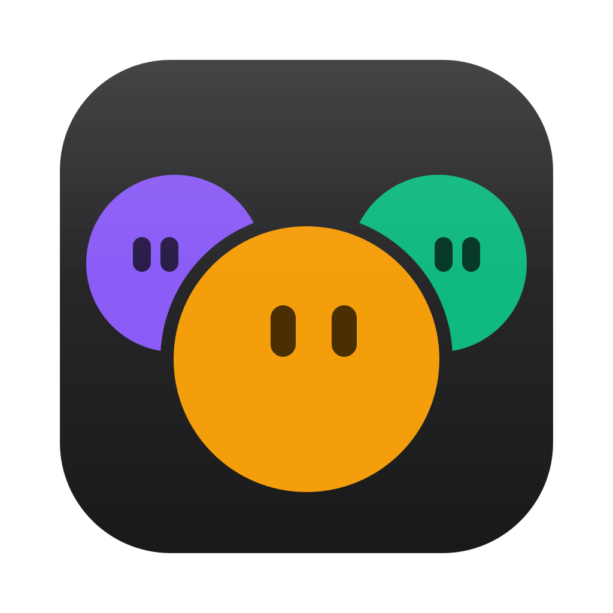
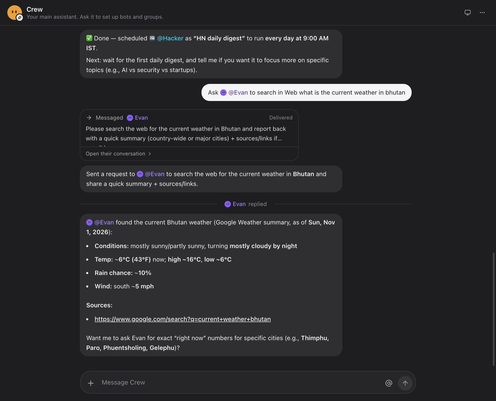

# Crew

Crew is a Mac app for AI teammates. Each bot has a job, a chat, and its own screen. One person shares one cloud computer across their bots, so they share files and browser logins and do not fight over the mouse. A bot can instead use this Mac. Connected apps come in through MCP. Turns run on the server, so closing the app does not stop the work.



An earlier 23-second recording, from before the redesign: [docs/crew.mp4](docs/crew.mp4).

It is a learning build of how a Grok Bot-style teammate works on the inside. The product model follows that shape. The architecture decisions are mine, and the source of Grok Bot is not. A longer walkthrough, with the flow and the tradeoffs, is at [avikmukherjee.com/blog/crew](https://avikmukherjee.com/blog/crew). The design notes and the build log are in [PRD.md](PRD.md).

## What a bot can do

- Read the thread and reply, including while you watch the text and the tool calls stream in.
- Use a 1280×800 screen on the shared cloud computer: browser, shell, and files. Or use this Mac, with command rules and a kill shortcut (`⌘⇧Esc`).
- Work desktop apps through their buttons and fields instead of guessing pixels. The bot reads an app's controls from the accessibility tree and acts on them by ref, on the cloud screen and on the Mac. Screenshots and clicks by position are kept for things with no controls, like canvases.
- Call the apps you connect. An active connection is available to every bot on the account. Tools that write can ask first.
- Message another bot. That exchange lives in its own thread, which you can read. In your chat you see who replied, and the bot that asked sums up the answer.
- Take a turn in a group. An @mention picks the bot. Otherwise a small router model does.
- Run on a schedule, once or on a cron, in the bot's own thread.

Sign-up can be limited to an email allowlist. There is no billing and no web client.

## How a message moves

1. The Electron app posts the message to the Hono API.
2. The API writes it, queues a run in Postgres, and starts it in the same process. A per-bot lock means each bot does one thing at a time.
3. The turn builds the prompt, opens the computer tools and the connector tools, and calls the model through the Neon AI Gateway.
4. Tool calls run against the cloud screen or, for a Mac bot, over a WebSocket the Mac opened outbound. The Mac is never a server on the internet.
5. The reply streams back to the app over server-sent events, chunk by chunk, and resumes where it left off after a dropped connection. Smaller facts, such as "the run finished", come over a second event stream.
6. You can open the bot's screen beside the chat. The app receives a short-lived ticket. It never holds the computer's own credentials.

## Layout

| Path | What it is |
|---|---|
| `apps/desktop` | Electron app: the UI, and the device agent that lets a bot use your Mac |
| `apps/server` | Hono API: auth, REST, live events, the turn runner, schedules, the screen proxy, the device relay, OAuth callbacks, and the Google MCP server |
| `packages/agent` | The turn and the runner: prompt, tools, approvals, the group router, and schedules |
| `packages/computer` | Cloud computers behind one provider interface. E2B is the default. Daytona implements the same interface |
| `packages/mcp` | Connector catalog, OAuth, transports, and the approval policy |
| `packages/db` | Drizzle schema and the Neon Postgres client |
| `packages/shared` | Types, limits, and the device protocol |

## Requirements

- Node 22 or newer, and pnpm 10
- A Neon Postgres database with the AI Gateway enabled
- An E2B API key, if bots should have a cloud screen

## Run it locally

```bash
pnpm install
cp .env.example .env
pnpm db:push
```

`.env.example` names every setting. The ones a local run needs are the database URLs, the AI Gateway URL and token, `E2B_API_KEY`, and the three random secrets (`BETTER_AUTH_SECRET`, `ENCRYPTION_KEY`, `DEVICE_TOKEN_PEPPER`). `openssl rand -hex 32` is enough for those. Leave `E2B_TEMPLATE_ID` empty to use E2B's stock desktop. `pnpm template:build` builds a faster image named `crew-computer` when you want one.

`ALLOWED_EMAILS` restricts sign-up. Empty means anyone who can reach the API can create an account.

Then two terminals:

```bash
pnpm dev:server     # API on http://localhost:8787, and where bot turns run
pnpm dev:desktop    # the app
```

Sign up, create a bot, and send it a message. The server must stay running for turns, schedules, and the ten-minute computer check. A schedule that comes due while the server is down runs once when it is back. If the server stops in the middle of a turn, that turn is not replayed, because it may already have sent something. The bot leaves a note in the chat instead.

The default model is `gpt-5-4-nano`, through the Neon AI Gateway. `ROUTER_MODEL` defaults to `claude-haiku-5-5` and is only used to pick who answers in a group. `SCREEN_MODEL` defaults to `gpt-5-4-mini` and takes over once a bot on the default model starts using a screen, because nano misses clicks by 50–100 pixels. Set any of them in `.env`. A bot can also pin its own model, which it then keeps for screen work too.

## Connectors

GitLab, Linear, Notion, and Sentry register their own OAuth clients. GitHub and Google need an OAuth app, with the callback `$SERVER_URL/oauth/mcp/callback`. Google is a first-party server in this repo for Gmail, Calendar, and Drive. Filesystem and Postgres are templates for a local stdio server, not connections you can turn on by themselves.

Connector tokens are encrypted at rest with `ENCRYPTION_KEY`. Do not rotate that key once a connection exists, or the stored tokens stop opening.

## Checks

```bash
pnpm typecheck
pnpm --filter @crew/computer smoke
```

The computer smoke test talks to a live E2B sandbox.

## macOS build

```bash
pnpm --filter @crew/desktop dist:mac
```

The packaged app updates itself from this repo's GitHub Releases.

## What is deliberately unfinished

The flows above are the ones that run. The PRD is ahead of the code in places: there is no separate wake task, no memory search tool, no tool the model can call to create a schedule, and the approval wait constant is not enforced. Treat the blog and this README as the description of what is built, and the PRD as the design it was built toward.
